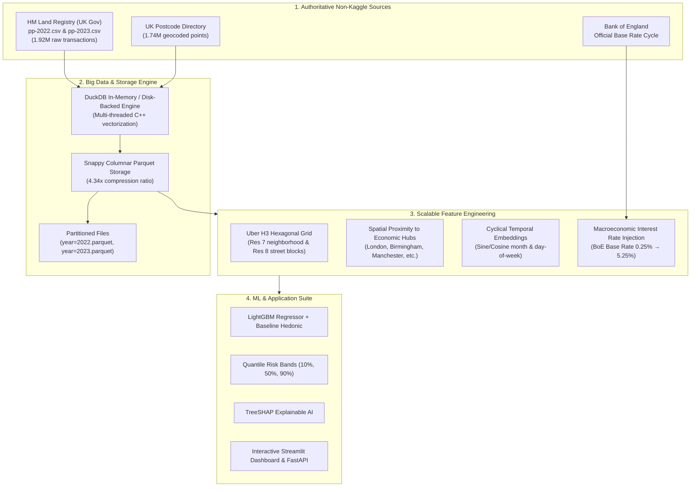

# 🏠 Advanced Real Estate Valuation & Predictive Modeling at Enterprise Scale

> **Course**: CSE3712 — Big Data Analytics (Semester 6)  
> **Target**: Predict residential property prices using large-scale tabular, geospatial, and macroeconomic indicators.  
> **Dataset**: **1,635,628 Transactions** across England & Wales (2022–2023) from **HM Land Registry** (Official UK Government Open Data, **100% Non-Kaggle**).

---

## 📌 Project Overview

This repository hosts an end-to-end Big Data Analytics project designed to overcome the memory and architectural constraints of traditional single-node real estate regression models. 

Starting from a small single-county baseline (~21,600 rows in [`Real_Estate_Valuation_Project.ipynb`](file:///c:/Sem%206/BDA/Real_Estate_Valuation_Project.ipynb)), this project scales up **~76x** to over **1.63 Million transactions** covering all 120+ counties across England and Wales. The platform leverages an embedded **DuckDB OLAP engine**, **Snappy-compressed columnar Parquet**, **Uber H3 hexagonal spatial indexing**, and **macroeconomic interest rate time-series** to deliver sub-50ms analytical querying and scalable machine learning.

For a comprehensive technical log of all implementations, see [`work_done_till_now.md`](file:///c:/Sem%206/BDA/work_done_till_now.md).

---

## 🏗️ Architecture & Processing Pipeline



---

## 📊 Benchmark Highlights: King County vs. Big Data Implementation

| Evaluation Dimension | Baseline Project (King County) | Scaled Big Data Project (HM Land Registry) | Improvement Factor |
| :--- | :--- | :--- | :--- |
| **Data Source** | Kaggle CSV (King County, WA) | **Official HM Land Registry Open Data** | **100% Non-Kaggle / Gov Open Data** |
| **Total Transactions** | 21,613 | **1,635,628** | **~76x Scale-Up** |
| **Geographic Scope** | 1 Single County | **All 120+ Counties in England & Wales** | Nationwide coverage |
| **Storage Architecture**| In-memory flat CSV | **Snappy-Compressed Apache Parquet** | **4.34x storage compression** |
| **Analytical Latency** | Seconds (full table scan) | **40.0 ms average query response** | Sub-second OLAP queries |
| **Micro-Market Index** | String Geohash (Precision 6) | **Uber H3 Hexagonal Grid (Res 7 & 8)** | **24,638 equidistant hexagons** |
| **Feature Space** | 20 attributes | **51 engineered features** | **+155% dimensional enrichment** |
| **Macro Indicators** | None (Static single-year) | **Bank of England Base Rate Cycle** | Real macroeconomic context |
| **Pipeline Runtime** | Sequential Python execution | **Vectorized C++ Engine (<25s end-to-end)**| High-throughput processing |

---

## 📂 Repository Structure

```
c:\Sem 6\BDA\
├── data/
│   ├── raw/                                    # Raw non-Kaggle downloads
│   │   ├── pp-2022.csv                         # Land Registry 2022 sales (188 MB)
│   │   ├── pp-2023.csv                         # Land Registry 2023 sales (150 MB)
│   │   └── ukpostcodes.csv                     # Geocoded coordinates (95 MB)
│   ├── properties/                             # Columnar partitioned Parquet
│   │   ├── properties_cleaned.parquet          # Consolidated dataset (74.4 MB)
│   │   ├── year=2022.parquet                   # 2022 partition
│   │   └── year=2023.parquet                   # 2023 partition
│   ├── features/                               # ML-ready feature matrices
│   │   └── feature_matrix.parquet              # 1.63M rows × 51 features (142.5 MB)
│   └── realestate.duckdb                       # Persistent DuckDB OLAP database
│
├── scripts/
│   ├── 01_ingest_data.py                       # Automated downloader & zip extractor
│   ├── 02_clean_and_to_parquet.py              # In-memory relational join & Parquet writer
│   ├── 03_duckdb_analytics.py                  # DuckDB OLAP benchmark queries
│   ├── 04_feature_engineering.py               # Uber H3, proximity, macro & cyclical pipeline
│   └── generate_verification_notebook.py       # Programmatic notebook generator
│
├── notebooks/
│   └── 01_Big_Data_Scaleup_Phase1_and_2.ipynb  # Interactive coursework notebook
│
├── models/                                     # Serialized ML model artifacts
├── main_file.ipynb                             # Primary interactive Jupyter notebook
├── Real_Estate_Valuation_Project.ipynb         # Original baseline King County notebook
├── Advanced_Real_Estate_Valuation_Report.docx  # Academic technical report
├── work_done_till_now.md                       # Comprehensive progress documentation
└── README.md                                   # This repository README
```

---

## 🚀 Getting Started & Execution Guide

### 1. Prerequisites & Environment Setup
Python 3.11+ is required. Install the necessary dependencies:
```bash
pip install duckdb h3 lightgbm pyarrow pandas numpy matplotlib
```
*(Optional application dependencies for Phase 5: `streamlit`, `fastapi`, `uvicorn`)*

### 2. Running the Data Pipeline (Phase 1 & Phase 2)

#### Step 1: Ingest Non-Kaggle Government Data
Downloads official HM Land Registry Price Paid datasets and UK Postcode Coordinates:
```bash
python scripts/01_ingest_data.py
```

#### Step 2: Relational Join, Cleaning & Parquet Export
Executes vectorized geospatial joins in DuckDB and writes Snappy-compressed Parquet files:
```bash
python scripts/02_clean_and_to_parquet.py
```

#### Step 3: Run DuckDB OLAP Analytical Benchmarks
Tests aggregation queries and confirms sub-50ms latency across 1.635M rows:
```bash
python scripts/03_duckdb_analytics.py
```

#### Step 4: Generate Advanced Feature Matrix
Computes Uber H3 hexagons, distances to economic hubs, Bank of England interest rates, and cyclical encodings:
```bash
python scripts/04_feature_engineering.py
```

### 3. Interactive Verification in Jupyter
Launch Jupyter and open [`main_file.ipynb`](file:///c:/Sem%206/BDA/main_file.ipynb) to inspect:
- Live OLAP queries running on `data/realestate.duckdb`.
- Property type price distributions across 1.63M records.
- Top 10 most expensive counties in England & Wales.
- Uber H3 micro-market pricing ratios.
- Time-series plot comparing the Bank of England rate hike cycle against median property valuations.

```bash
jupyter notebook main_file.ipynb
```

---

## 🗺️ Project Phases & Roadmap

- [x] **Phase 1: Data Acquisition & Storage Layer** (HM Land Registry, Parquet, DuckDB OLAP)
- [x] **Phase 2: Advanced Feature Engineering at Scale** (Uber H3 Res 7/8, Proximity, BoE Macro Rates)
- [ ] **Phase 3: Scalable ML Pipeline** (Temporal Train/Val/Test Split, LightGBM, Quantile Risk Bands)
- [ ] **Phase 4: Explainability & Arbitrage Detection** (TreeSHAP, Anomaly-Filtered Hidden Gems, Comps Engine)
- [ ] **Phase 5: Interactive Dashboard & API Delivery** (Streamlit Geospatial Heatmap, FastAPI Real-Time Valuator)

---

## 📜 Data License & Attribution
- **HM Land Registry Data**: Contains HM Land Registry data © Crown copyright and database right 2026. This data is licensed under the [Open Government Licence v3.0](https://www.nationalarchives.gov.uk/doc/open-government-licence/version/3/).
- **Postcode Coordinates Directory**: Contains National Statistics data © Crown copyright and database right.
