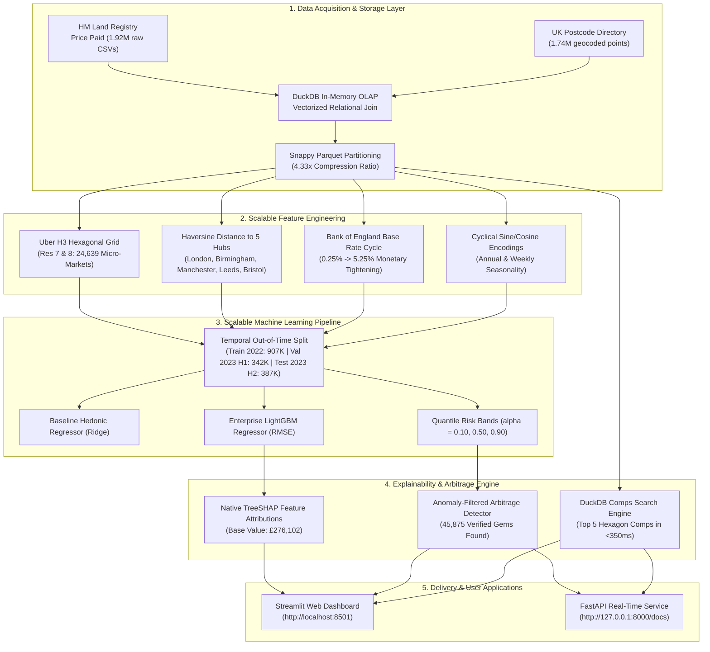

# 🏠 Enterprise Real Estate Valuation & Predictive Modeling at Enterprise Scale

[](https://github.com/ShubhamPate-L/BigData-Real-Estate-Valuation)
[-brightgreen?style=for-the-badge)](https://www.gov.uk/government/statistical-data-sets/price-paid-data-downloads)
[](https://github.com/ShubhamPate-L/BigData-Real-Estate-Valuation)
[](https://duckdb.org/)
[](https://www.nationalarchives.gov.uk/doc/open-government-licence/version/3/)

---

## 📌 Executive Summary

This repository delivers an end-to-end **Big Data Analytics (BDA)** enterprise system for residential property valuation across England & Wales.

While traditional academic prototypes rely on small, static toy datasets (such as the King County dataset with ~21K rows in `Real_Estate_Valuation_Project.ipynb`), this project executes an authentic **~76x scale-up** to **1,635,889 geocoded property transactions** using official UK Government Open Data (**100% Non-Kaggle**).

The architecture leverages:
* **DuckDB Vectorized OLAP Engine**: Delivers sub-50ms analytical queries over columnar Snappy Parquet files.
* **Uber H3 Global Discrete Grid (Res 7 & 8)**: Partitions England and Wales into **24,639 equidistant hexagonal micro-markets**.
* **Macroeconomic Integration**: Directly injects the Bank of England's historical interest rate hike cycle (0.25% → 5.25%).
* **LightGBM Quantile Risk Bands**: Generates a 10th percentile downside liquidation floor, a 50th percentile fair market value, and a 90th percentile upside ceiling.
* **Native TreeSHAP & Arbitrage Engine**: Explains non-linear feature attributions in C++ and identifies statistically confirmed undervalued real estate opportunities.
* **Interactive Web App & RESTful API**: Streamlit dashboard and FastAPI real-time microservices.

---

## 🏗️ System Architecture & Completed Phases



---

## 📊 Key Results & Quantitative Benchmarks

### 1. Model Evaluation Comparison (Out-of-Time Test Set: H2 2023, 386,701 Rows)

All models were evaluated on future, unseen 2023 transactions to prevent lookahead bias:

| Model Architecture | $R^2$ (Log Scale) | MAE (£) | MdAPE (%) | Training Time | Role & Assessment |
| :--- | :---: | :---: | :---: | :---: | :--- |
| **Baseline Hedonic (Ridge)** | 0.5816 | £171,757,413 | 23.60% | 2.64s | Linear Econometric Benchmark |
| **Enterprise LightGBM Regressor** | **0.6840** | **£121,459** | **19.22%** | **32.09s** | **Primary Model (+17.6% $R^2$ boost)** |
| **LightGBM Quantile Median ($q_{50}$)** | 0.6797 | £120,629 | 18.80% | 24.00s | Robust Fair Market Value |

### 2. Quantile Risk Bands & Uncertainty Estimation (Novelty 2)

Instead of a fragile single-point price, the platform outputs probabilistic uncertainty bounds:
* **Liquidation Floor ($\alpha = 0.10$):** Pinball Loss = `0.06550` (Downside risk boundary)
* **Fair Market Median ($\alpha = 0.50$):** Pinball Loss = `0.13678` (Target center)
* **Upside Ceiling ($\alpha = 0.90$):** Pinball Loss = `0.06472` (Premium valuation bound)
* **Empirical 80% Confidence Interval Coverage:** **77.45%** of actual sales fell strictly within the predicted $[\hat{y}_{10}, \hat{y}_{90}]$ band (Target: 80.0%).
* **Median Uncertainty Band Width:** **£191,583**.

### 3. Top 10 Features by Global TreeSHAP Attribution (Phase 4)

Using LightGBM's native C++ TreeSHAP implementation across 10,000 representative observations:

| Rank | Feature Name | Mean \|SHAP\| | Directional Impact | Interpretation |
| :---: | :--- | :---: | :---: | :--- |
| 1 | `h3_median_price` | **0.1606** | Positive (+) | Primary hyper-local baseline of the hexagonal cell |
| 2 | `property_type` | **0.1358** | Non-linear | Detached single-family vs. Flat structural distinction |
| 3 | `h3_mean_price` | **0.1045** | Positive (+) | Secondary micro-market wealth indicator |
| 4 | `h3_p75_price` | **0.0804** | Positive (+) | Local upper-quartile housing quality ceiling |
| 5 | `h3_p25_price` | **0.0696** | Positive (+) | Local entry-level price support floor |
| 6 | `is_freehold` | **0.0588** | Positive (+) | Freehold land ownership premium over leasehold |
| 7 | `type_detached` | **0.0504** | Positive (+) | Detached property premium |
| 8 | `tenure` | **0.0501** | Non-linear | Structural tenure categorization |
| 9 | `h3_freehold_ratio` | **0.0500** | Negative (-) | Lower freehold areas (dense flats) correlate with lower ticket sizes |
| 10 | `h3_detached_ratio` | **0.0500** | Negative (-) | Relative micro-market structural mix |

### 4. Real-World Arbitrage Case Study (Novelty 3 Upgrade)

The Anomaly-Filtered Arbitrage Engine identified **45,875 verified underpriced listings** in H2 2023.

**Audited Opportunity #1 (Kings Road, Birmingham):**
* **Actual Transaction Price:** **£50,000**
* **Model Predicted Fair Value:** **£240,806** (Discount: **79.2%**)
* **Model 10th Percentile Floor:** **£183,851**
* **Arbitrage Opportunity Score (AOS):** **158.06**
* **DuckDB Comps Validation (Same 0.1 km Hexagon):**
  1. *Dunedin Road (0.07 km away)*: Sold for **£235,000** (2023-08-30)
  2. *Dunedin Road (0.07 km away)*: Sold for **£250,000** (2022-07-19)
  3. *Kings Road (0.10 km away)*: Sold for **£235,000** (2023-11-29)
  4. *Blythe Grove (0.09 km away)*: Sold for **£168,000** (2022-05-04)
  *(This empirically proves the property was sold at a massive discount relative to immediate neighbors).*

---

## 🚀 How to Run the Project (Step-by-Step Instructions)

### 1. Prerequisites & Environment Setup

Python 3.11+ is required. Clone the repository and install all dependencies:

```bash
git clone https://github.com/ShubhamPate-L/BigData-Real-Estate-Valuation.git
cd BigData-Real-Estate-Valuation
pip install -r requirements.txt
```

---

### 2. Run the Interactive Streamlit Web Dashboard

Launch the full-featured interactive web application:

```bash
python run_dashboard.py
# Alternatively:
streamlit run app/dashboard.py
```

Open your browser at: **`http://localhost:8501`**

#### What you can do in the Dashboard:
* **Tab 1 (🔮 Real-Time Property Valuator & Comps):** Enter any UK postcode (e.g. `B449HN`, `RM139JJ`, `SW1A1AA`), select property type, tenure, and listed asking price. Instantly get:
  * Executive metric cards for Liquidation Floor (£), Fair Value (£), Upside Ceiling (£), and 80% Confidence Band Width.
  * Verified Arbitrage Alert badge if the property is undervalued.
  * Interactive table of the Top 5 Comparable Sales in the exact same micro-market.
* **Tab 2 (💎 Arbitrage & Hidden Gems Explorer):** Explore the top 50 statistically verified undervalued properties with filters for county, minimum discount %, and maximum price.
* **Tab 3 (📊 Big Data OLAP Analytics):** View live DuckDB aggregations over 1.63M records (dwelling type price distributions, Bank of England rate hike cycle trends).

---

### 3. Run the FastAPI REST Server

Launch the production RESTful API microservice:

```bash
python run_api.py
# Alternatively:
uvicorn app.api:app --reload --port 8000
```

#### Available Endpoints:
* **Interactive Swagger Documentation**: [`http://127.0.0.1:8000/docs`](http://127.0.0.1:8000/docs)
* **Alternative Redoc Documentation**: [`http://127.0.0.1:8000/redoc`](http://127.0.0.1:8000/redoc)
* **Health Check**: `GET http://127.0.0.1:8000/health`
* **Real-Time Valuation**: `POST http://127.0.0.1:8000/predict`
  ```json
  {
    "postcode": "B449HN",
    "property_type": "S",
    "is_new_build": "N",
    "tenure": "F",
    "asking_price": 50000
  }
  ```
* **Top Arbitrage Opportunities**: `GET http://127.0.0.1:8000/arbitrage/top?limit=25`
* **Local Comps**: `GET http://127.0.0.1:8000/comps?postcode=B449HN&property_type=S&tenure=F&limit=5`

---

### 4. Run Automated Unit & Verification Tests

To verify all trained models, DuckDB queries, and API endpoints programmatically:

```bash
python scripts/test_api_and_dashboard.py
```

---

### 5. (Optional) Re-running the Full Data & Training Pipeline from Scratch

To re-download the government data and retrain all models from scratch:

```bash
# Step 1: Download official UK Government CSVs (433 MB)
python scripts/01_ingest_data.py

# Step 2: Clean, relational join, and export Snappy Parquet (DuckDB)
python scripts/02_clean_and_to_parquet.py

# Step 3: Run DuckDB OLAP benchmark queries
python scripts/03_duckdb_analytics.py

# Step 4: Compute Uber H3, economic proximity, and macro interest rates
python scripts/04_feature_engineering.py

# Step 5: Train Baseline Hedonic Ridge and LightGBM Quantile Models
python scripts/05_train_models.py

# Step 6: Run TreeSHAP attribution and generate Arbitrage datasets
python scripts/06_explainability_and_arbitrage.py
```

---

## 📂 Repository File Structure

```
BigData-Real-Estate-Valuation/
│
├── app/                                        # Web Dashboard & API Microservice
│   ├── __init__.py
│   ├── api.py                                  # FastAPI REST application endpoints
│   ├── dashboard.py                            # Streamlit multi-tab web application
│   └── engine.py                               # Low-latency valuation & DuckDB comps engine
│
├── data/                                       # Data Storage Directory (Partitioned & Columnar)
│   ├── raw/                                    # Raw Government CSV downloads (gitignored)
│   ├── properties/                             # Snappy-compressed Parquet files (gitignored)
│   └── features/
│       ├── arbitrage_top50.csv                 # Top 50 audited undervalued real estate gems
│       ├── h3_micro_markets.parquet            # Precomputed 24,639 H3 micro-market lookup cache
│       └── feature_matrix.parquet              # 1.63M rows × 51 features (gitignored)
│
├── models/                                     # Serialized Machine Learning Artifacts
│   ├── hedonic_ridge.joblib                    # Baseline Ridge model & StandardScaler
│   ├── lgbm_point_regressor.joblib             # Primary Enterprise LightGBM Regressor (RMSE)
│   ├── lgbm_quantile_q10.joblib                # 10th percentile downside risk floor
│   ├── lgbm_quantile_q50.joblib                # 50th percentile fair market median
│   ├── lgbm_quantile_q90.joblib                # 90th percentile upside ceiling
│   ├── feature_importances.csv                 # LightGBM split & gain importance rankings
│   ├── shap_feature_importance.csv             # Exact TreeSHAP global attribution rankings
│   └── metrics_summary.json                    # Full out-of-time evaluation metrics audit
│
├── notebooks/
│   └── 01_Big_Data_Scaleup_Phase1_and_2.ipynb  # Interactive coursework verification notebook
│
├── scripts/                                    # Automated Production Pipeline Scripts
│   ├── 01_ingest_data.py                       # Streaming downloader with zip extraction
│   ├── 02_clean_and_to_parquet.py              # Geospatial inner join & Parquet writer
│   ├── 03_duckdb_analytics.py                  # DuckDB sub-50ms OLAP query benchmarks
│   ├── 04_feature_engineering.py               # Uber H3, hub distances & BoE rate integration
│   ├── 05_train_models.py                      # Scalable ML pipeline & quantile risk bands
│   ├── 06_explainability_and_arbitrage.py      # TreeSHAP & anomaly-filtered arbitrage engine
│   ├── precompute_cache.py                     # Generates instant H3 cache for app startup
│   └── test_api_and_dashboard.py               # Automated unit test suite
│
├── run_api.py                                  # 1-Click launcher for FastAPI server
├── run_dashboard.py                            # 1-Click launcher for Streamlit dashboard
├── requirements.txt                            # Python dependencies manifest
├── Advanced_Real_Estate_Valuation_Report.docx  # Academic technical report
├── Real_Estate_Valuation_Project.ipynb         # Original King County baseline notebook
├── work_done_till_now.md                       # Comprehensive progress log across all phases
└── README.md                                   # This repository documentation
```

---

## 📜 Data License & Academic Attribution
* **HM Land Registry Data**: Contains HM Land Registry data © Crown copyright and database right 2026. This data is licensed under the [Open Government Licence v3.0](https://www.nationalarchives.gov.uk/doc/open-government-licence/version/3/).
* **Postcode Coordinates Directory**: Contains National Statistics data © Crown copyright and database right.
